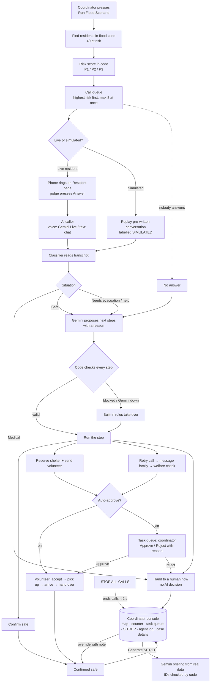

# How LastMile works (M0 → M4)

> How to update: when a milestone lands, add a row to "What each milestone added", extend the diagram, and
> date the change at the bottom. Keep it plain English; technical detail lives in `docs/ARCHITECTURE.md`.

## The problem in one line

Flood warnings reach phones and TVs, but nobody checks that the **elderly, disabled, or non-English-speaking
people living alone** are actually safe. Today coordinators phone down paper lists by hand.

## What LastMile does in one line

When a flood alert is issued, LastMile **finds everyone at risk, calls each one in their own language,
works out what they need, and keeps going until every person is confirmed safe or handed to a human.**

---

## A real example: 6:00 pm, flash flood warning for Sungai Indah

1. **The alert starts the system.** A coordinator presses **Run Flood Scenario**.
   40 vulnerable residents are inside or near the flood zone.
2. **Who first?** Each person gets a risk score in code, not AI: age, living alone, wheelchair or walker,
   oxygen or dialysis, ground floor, distance to the river.
   _Mdm Tan, 82, lives alone, ground floor, uses a walker, 50 m from the river → score 73, priority P1._
   The highest-risk people are called first, up to 8 at a time.
3. **The call.** LastMile phones each person:
   - **Mdm Tan is a "live" resident:** her phone rings on the Resident page and a person (a judge) answers.
     The AI caller speaks first: _"Hello Mdm Tan, I am an automated assistant…"_. She says the water is
     coming in and she uses a walker. The caller records **Needs evacuation** and tells her a volunteer is
     coming, to bring her ID and medicines.
   - **The other 38 are simulated** (labelled SIMULATED everywhere), so the demo runs without 40 real people.
4. **Understanding the answer.** A classifier reads the transcript and decides: safe / needs evacuation /
   needs help / medical / no answer. When the caller and the classifier disagree, LastMile picks the **more
   cautious** answer.
5. **Deciding the next step (Gemini, checked by code).** Gemini proposes, for example, _"Reserve Civic Care
   Centre (wheelchair accessible, medical support), then send volunteer V-6 who speaks Mandarin."_ Code
   checks each step: is it allowed, does that shelter exist and have space, is the volunteer free? Anything
   wrong is **blocked**, and the built-in rules take over.
6. **The coordinator approves (M5).** The proposed dispatch appears in the console's **Task queue**: _"Mdm Tan,
   82, walker, speaks Mandarin. Escort to Civic Care Centre. Volunteer V-6."_ The coordinator clicks
   **Approve**, or **Reject** with a reason such as _"Road to Civic Care is flooded"_, which frees the
   volunteer and hands the case to a person. With **Auto-approve** on, this step is skipped.
7. **Help arrives.** The volunteer accepts, picks her up, arrives at the shelter and hands over. Her case
   becomes **Confirmed safe**. (Volunteers are bots in Phase 1.)
8. **Other people, other paths.**
   - _Mr Lee says "I'm fine, upstairs with my son"_ → confirmed safe straight away.
   - _Mdm Ong says "my husband fell and can't get up"_ → **medical**: handed to a human immediately,
     before any AI decision.
   - _Nobody answers Mr Goh_ → retry, retry again, then message his son (simulated), then send a volunteer
     for a welfare check.
     A pop-up tells the coordinator: _"R-017: Message sent to daughter (+60 1X-XXX 9565) — simulated"_.
   - _A confused answer_ → handed to a human for review.
9. **The coordinator stays in charge (M5).**
   - **Override:** _the coordinator phones Mdm Ong's son, who says the ambulance took her husband and she is
     with a neighbour._ They open her case, write that note, and click **Mark confirmed safe**. A note is
     always required, and it goes into the audit trail.
   - **Situation report:** one click on **Generate SITREP** gives a short briefing written from real system
     data only, for example _"26/40 confirmed safe, 5 escalated. Urgent: R-008, R-012… Resources: S-3 3/10;
     1 volunteer available. Next 10 minutes: review 5 escalations; approve 7 dispatches."_ Code checks that
     every ID in it really exists; otherwise a rule-based report is shown instead.
10. **The coordinator watches it all live:** map, counter ("36 / 40 confirmed safe"), task queue, situation
    report, status table, agent log with a reason for every action, and case details with transcripts.
    **STOP ALL CALLS** ends everything in under 2 seconds.

**End state of a typical run:** about 36 confirmed safe, 4 handed to a human, **nobody stuck**.

---

## The whole flow

---

## What each milestone added

| Milestone                | In simple terms                                                                                                              | Real-life value                                                                             |
| ------------------------ | ---------------------------------------------------------------------------------------------------------------------------- | ------------------------------------------------------------------------------------------- |
| **M0 Foundations**       | Project set up: data model, 40 synthetic residents, 3 shelters, 8 volunteers, local database, team docs, CI checks           | Anyone on the team can run it in 5 minutes with no cloud account or key                     |
| **M1 Core rules**        | The "rule book": allowed status changes, risk scoring, shelter and volunteer matching                                        | Nobody can be marked safe by mistake; wheelchair users never go to a shelter without access |
| **M2 The full loop**     | Queue → calls → classify → rules decide → volunteers → confirmed safe, plus the live console and kill switch                 | The system works end to end even with **no AI at all**                                      |
| **M3 AI decisions**      | Gemini proposes each next step with a reason; code validates it; agent log, case details, AI badge                           | Decisions are explainable, and AI mistakes are caught before they affect a person           |
| **M4 Live call**         | A real conversation: the phone rings, a person answers, and the AI talks in their language (voice or typed chat)             | The key demo moment: talk to the AI as a resident and watch the system react                |
| **M5 Human in the loop** | Coordinator approves or rejects dispatches, overrides any case with a note, gets an AI situation report; next-of-kin pop-ups | People, not AI, have the final say; every human decision is recorded                        |

## Safety rules that always hold

- **Code decides, AI proposes.** Every AI step is checked; invalid ones are blocked and logged.
- **Medical → human first**, before any AI decision.
- **Nobody gets stuck:** if the AI fails, times out or runs out of quota, the built-in rules finish the case.
- **The AI says it's automated** in its first sentence, and never gives medical advice or invents facts.
- **Kill switch** ends every call in under 2 seconds.
- **Humans can always overrule:** approve or reject any dispatch, and override any case, always with a note.
- **Reports only use real data:** situation reports that mention an unknown resident, shelter or volunteer are replaced.
- **Synthetic data only.** Simulated items are always labelled; phone numbers are masked.

## Where things run

| Piece                              | Where                                                      | Link                                      |
| ---------------------------------- | ---------------------------------------------------------- | ----------------------------------------- |
| Web app (console + resident phone) | Firebase Hosting                                           | https://lastmile-resilience-agent.web.app |
| Backend API + calls                | Cloud Run (`lastmile-api`, asia-southeast1)                | `/api/health` on the Cloud Run URL        |
| Data                               | Firestore                                                  | Firebase console → Firestore              |
| AI                                 | Gemini API (decisions, classifier) and Gemini Live (voice) | key in Secret Manager `gemini-api-key`    |

## Status and what's next

| Milestone | Status                                                                                                                                      |
| --------- | ------------------------------------------------------------------------------------------------------------------------------------------- |
| M0–M2     | Done and deployed                                                                                                                           |
| M3–M5     | Merged to `main`; backend redeployed in real-Gemini mode; frontend redeploy and the Actions deploy (Owner setup) pending                    |
| M6        | Eval sets, eval runner (`make evals`), metrics (`make metrics`) and security review built on `feat/evals-metrics`; real-Gemini runs pending |
| Next      | Deploy → `make evals` + 3 deployed runs → deck + video → **M7** submit, 18 Oct                                                              |

_Last updated: 2026-10-17 (M6 tooling built)._
